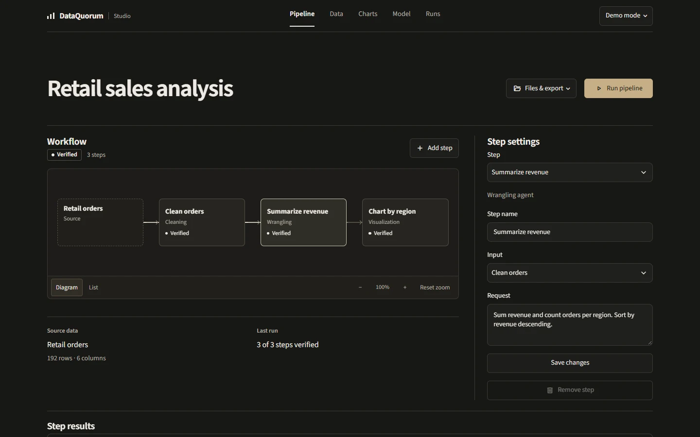

# DataQuorum

**A team of AI data-science agents that must prove their work.**

DataQuorum is a Python library and local Studio for running data-science workflows. Agents
write pandas, SQL, or scikit-learn code from plain-English requests. The runtime executes the
code in an isolated environment and issues `success`, `failed`, or `needs_review` based on
validation. Each result includes the checks and the code that ran.

## Try Studio offline

Clone the repository and run these commands in PowerShell or Bash with Python 3.12 and uv
available. The bundled retail demo uses fixed code and the same validation checks. It needs
neither Docker nor an API key.

```text
git clone https://github.com/krtk06/dataquorum
cd dataquorum
uv run --locked --extra studio dataquorum-studio
```

1. Open [Studio on localhost](http://127.0.0.1:8501) and select **Run pipeline**.
2. Open a step under **Step results** to inspect its checks. **Charts** shows revenue by region.
3. Open **Files & export** to save the recipe as JSON or download runnable Python.



[Watch the captioned Studio walkthrough](https://github.com/krtk06/dataquorum/blob/main/docs/media/studio-demo.mp4) ·
[Read the walkthrough and Studio requirements](https://github.com/krtk06/dataquorum/blob/main/docs/results/week15-16-studio.md)

## Run a live agent

Requires Python 3.12, [uv](https://docs.astral.sh/uv/), Docker, and an OpenAI-compatible API
key (developed against DeepSeek V4.1 Flash via OpenCode Go).

```bash
uv sync
docker build -t dataquorum/sandbox:0.4 -f images/sandbox/Dockerfile .
cp .env.example .env   # then add OPENCODE_GO_API_KEY
```

```python
import pandas as pd
from dataquorum.agents import CLEANING, WRANGLING, make_engine

df = pd.DataFrame({"price": ["$1,200", "n/a", "$3.4k"], "city": [" boston", "NYC", "boston"]})

run = make_engine(CLEANING).start(
    df, "Convert price to numbers ('$3.4k' = 3400, 'n/a' = missing). Strip and title-case city."
)
result = run.result
print(result.status, result.message)
if result.output is not None and result.output.kind == "dataframe":
    print(result.output.load())
print(result.code)
print(result.usage.allowance_usd, result.usage.calls)
```

Ask for a plan first and approve it:

```python
engine = make_engine(WRANGLING)
run = engine.start(df, "Average price per city", human_review=True)
print(run.review["steps"])                  # the proposed steps
run = engine.resume(run.run_id, "Yes")      # or "Use the median instead", or "no: wrong column"
```

The visualization agent returns a Plotly figure. For a live Studio run, open **Demo mode** and
enable **Live agents**. A live run sends a data preview to OpenCode Go and uses allowance.

## Audit a prediction task

```python
from dataquorum.agents import CORRECTNESS, make_engine
from dataquorum.ml.report import forest_report

run = make_engine(CORRECTNESS).start(samples, "Audit classification. The target is churn.")
print(run.result.status, run.result.message)
if run.result.output is not None:
    print(run.result.output.load())

# With numeric predictors and a split column containing train/test labels
curve = forest_report(samples, "churn", problem="classification", report="calibration")
```

A copied target or a customer appearing in both partitions warrants review. A verified audit
with a flagged risk ends in `needs_review`. The `forest_report` API accepts `tuning`,
`shap` or `calibration` and fits on training rows only. Calibration uses binary outcomes.
See [week 11 results and limits](https://github.com/krtk06/dataquorum/blob/main/docs/results/week11-correctness.md).

## Register and serve a trained model

In PowerShell from the repository root, install the serving tools with
`uv sync --locked --extra serving` and build sandbox 0.4 using the quick-start command.
Given a DataFrame named `samples` with a `churn` target, finite numeric predictors and a
`split` column with `train` and `test` values:

```python
from pathlib import Path

from dataquorum.ml.export import export_forest
from dataquorum.ml.registry import ForestRegistry

artifact = export_forest(samples, "churn", Path("runs/forest.zip"), problem="classification")
registry = ForestRegistry(Path("runs/registry"))
registered = registry.register("churn", artifact)
print(registered.version)
```

Start FastAPI with the printed version. A fresh registry starts at version 1.

```powershell
uv run --locked --extra serving python -m dataquorum.ml.serving churn 1
```

The interactive API docs are at `http://127.0.0.1:8000/docs`. `GET /schema` lists the
features for the selected version. Send `{"rows": [...]}` to `POST /predict` with one
object per row and every feature named explicitly.

To compare input distributions, save reference and current feature batches as Parquet.
Use the loaded model's `prepare(frame)` to validate and order each batch before writing it.

```powershell
uv run --locked --script scripts/model_drift.py reference.parquet current.parquet runs/drift.html
```

The script writes the visual report and prints machine-readable drift metrics. See
[Week 12 verification](https://github.com/krtk06/dataquorum/blob/main/docs/results/week12-deployment.md).

## Chain agents with the supervisor

```python
from dataquorum.supervisor import make_supervisor

run = make_supervisor().start(df, "Clean the price column and chart price by city.")
print(run.result.status, run.result.message)
print([(step.agent, step.status) for step in run.children])
```

The supervisor routes each step, forwards validated tables, and keeps the exact request in
every child run. Read `run.decisions` for route instructions and reasons. A blocked step or
refusal stops the workflow with its explanation. See the
[Week 13 routing experiment](https://github.com/krtk06/dataquorum/blob/main/docs/results/week13-routing.md).

## How it proves its work

- **Structured output only.** The model returns a validated object with a `python_code`
  field; code is never scraped from free text.
- **Isolated execution.** Generated Python runs with a restricted Docker environment. SQL
  uses a read-only database connection and a query guard.
- **Checks decide the status.** Generic checks (output not empty, rows or columns lost
  without being asked, missing values added, numbers turned into text) plus agent-specific
  ones. A failed blocking check triggers a fix attempt; warnings give `needs_review`.
- **Early refusal.** When planning identifies an infeasible request, the run returns
  `failed` before generating code.
- **Live agent runs are recorded** in DuckDB with usage, timing, checks, and code. The budget
  guard uses the provider's metered allowance.

## What the evaluations show

In a paired 55-task comparison with the original project, DataQuorum got 55 tasks correct and
reported zero false successes. The original got 47 correct and reported seven false successes.
The same model and retry budget were used on both sides. The suite was developed alongside
DataQuorum, so the result applies to those tasks. [Parity methods and caveats](https://github.com/krtk06/dataquorum/blob/main/docs/results/week7-parity.md)

Two write-ups cover the main engineering findings.

- [Detecting false successes in data-science agents](https://github.com/krtk06/dataquorum/blob/main/docs/writeups/verified-agent-outputs.md)
- [What more training examples changed in agent routing](https://github.com/krtk06/dataquorum/blob/main/docs/writeups/learning-to-route.md)

## Reproduce the evaluations

114 tasks, including 102 on five OpenML datasets (adult, credit-g, telco-customer-churn, ames-housing,
diabetes) and 12 on a seeded ML audit fixture with hand-labelled answers. Checkers compare
outputs by value; an oracle check proves every task is solvable and not trivial.

```bash
uv sync --group evals
uv run python -m dataquorum.evals.runner --label my-run          # needs Docker + API key
uv run python -m dataquorum.evals.compare runs/evals/<A> runs/evals/<B>
```

Results so far: [week 6 baseline](https://github.com/krtk06/dataquorum/blob/main/docs/results/week6-baseline.md),
[week 7 parity](https://github.com/krtk06/dataquorum/blob/main/docs/results/week7-parity.md), [week 8 hard tasks](https://github.com/krtk06/dataquorum/blob/main/docs/results/week8-hard-tasks.md),
[week 9 new agents](https://github.com/krtk06/dataquorum/blob/main/docs/results/week9-new-agents.md),
[week 10 AutoML benchmark](https://github.com/krtk06/dataquorum/blob/main/docs/results/week10-automl.md),
[reasoning-effort experiment](https://github.com/krtk06/dataquorum/blob/main/research/reasoning_effort/README.md).
The [Week 14 study](https://github.com/krtk06/dataquorum/blob/main/docs/results/week14-study.md) has offline controls and a prepared live
protocol. The paired live study is pending.

## Project layout

```
src/dataquorum/
  core/      llm (structured output, cost, budget), engine (LangGraph), state, checks, review
  agents/    cleaning, wrangling, visualization, loader, sql, eda, features, correctness (AgentSpecs)
  sandbox/   Docker executor
  tracing/   DuckDB run recorder
  evals/     datasets, faults, tasks (YAML), checkers, oracle, runner, stats, parity
  ml/        AutoML, correctness audits, tuning, SHAP explanations and calibration
  supervisor/ routing and multi-step orchestration
  app/       Studio, pipeline recipes, exports, and demo
images/      sandbox, original (parity), autogluon, automl
docs/        spec, bug log of the original, results
```

## Development

```bash
uv run pytest            # Docker tests skip unless the sandbox image is built
uv run ruff check . && uv run ruff format --check .
uv run mypy
```

CI runs lint, strict type checks and tests on Ubuntu and Windows, against pandas 2 and 3,
plus the sandbox escape tests in Docker.

[Release build and verification](https://github.com/krtk06/dataquorum/blob/main/docs/results/week17-release.md)

## Credits

Inspired by [business-science/ai-data-science-team](https://github.com/business-science/ai-data-science-team)
by Matt Dancho (MIT). DataQuorum is an independent reimplementation and shares no code with
it; the parity eval runs the original unmodified in its own container.

## License

MIT
