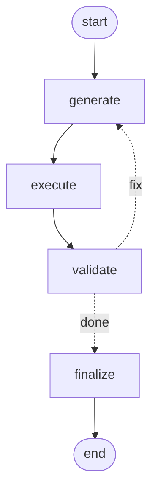

# Mini agent: learning LangGraph (week 2, throwaway)

A small agent that writes pandas code, runs it in the Docker sandbox, checks the output and
retries on failure. It uses the real `core/llm.py` and `core/state.py`, so the week-3 engine
can grow out of the same ideas. It is not part of the library and will be deleted once the
engine exists.

```bash
cd research/mini_agent
uv run python agent.py                    # normal run
uv run python agent.py --sabotage-first   # first attempt is replaced with broken code
uv run python agent.py --show-graph       # print the graph as Mermaid
```

Needs Docker running, the `dataquorum/autogluon:1.6.3` image, and the Go key in `.env`.
Each run costs about $0.0005–0.0015 of allowance.

## The graph



## LangGraph concepts, mapped to the code

| Concept | Where in `agent.py` | What to notice |
|---|---|---|
| **State** | `MiniState` (Pydantic) | One object holds everything: task, attempt count, code, last error, checks, usage, final result. |
| **Node** | `Generate`, `execute`, `validate`, `finalize` | A node takes the state and returns a dict of **only the fields it changes**. LangGraph merges that dict into the state. |
| **Edge** | `add_edge("generate", "execute")` | Fixed order. |
| **Conditional edge** | `add_conditional_edges("validate", route_after_validate, ...)` | A plain function looks at the state and returns a label (`"fix"` or `"done"`). The retry loop is just an edge pointing back to `generate`. |
| **Compile + invoke** | `build_graph()`, `app.invoke(MiniState(...))` | `compile()` checks the wiring; `invoke()` runs nodes until `END` and returns the final state as a dict. |
| **Node with dependencies** | `class Generate` | A node can be any callable. Using a class lets it hold the LLM client without globals. |

## What the two demo runs showed (2026-11-16)

| Run | Path through the graph | Result | Cost |
|---|---|---|---|
| Normal | generate → execute → validate → done | success, 1 attempt | 1 call, 613 out tokens, $0.0005 |
| `--sabotage-first` | generate (broken) → execute fails with `KeyError` → **fix** → generate → execute → validate → done | success, 2 attempts | 2 calls, 1,726 out tokens, $0.0013 |

On the fix attempt the LLM is shown the error and the failed code (`feedback()` in
`agent.py`). A failed **blocking check** is fed back the same way, so "the code ran but
the output was wrong" also gets a retry, not only crashes.

**Lesson for week 3: a status is only as honest as its checks.** Both runs left
`"san  francisco"` as `"San  Francisco"` (two spaces). The task did not ask for spaces to be
collapsed and no check looked for it, so the result is a "success". The engine needs
task-specific checks, and the eval suite (week 6) needs checkers that compare against a
known answer, as `research/reasoning_effort/harness.py` does.

## What the week-3 engine adds on top

- `summarize` and `recommend` nodes before code generation (the original's flow).
- A **human review** step using LangGraph's `interrupt()`, with a typed reply
  (`Approve`, `Revise(...)`, `Reject(...)`), and a **checkpointer** so a paused run can
  resume.
- Agent-specific prompts and checks plugged into one shared graph, instead of hard-coded
  ones.
- The real sandbox (`sandbox/docker_executor.py`, week 5) and the run recorder (week 4).

## Try it yourself

1. Change `max_attempts` to 1 and run with `--sabotage-first`. The status should be
   `failed`, with the `KeyError` as the error, and no false success.
2. Add a check `city_single_spaces` (blocking) to `validate()`. Run again and watch the
   agent retry until the code collapses the spaces.
3. Add a `print(state.attempt)` at the start of each node to see the order LangGraph calls them.
4. Run `--show-graph` after changing an edge, and paste the output into
   https://mermaid.live to see the new shape.
